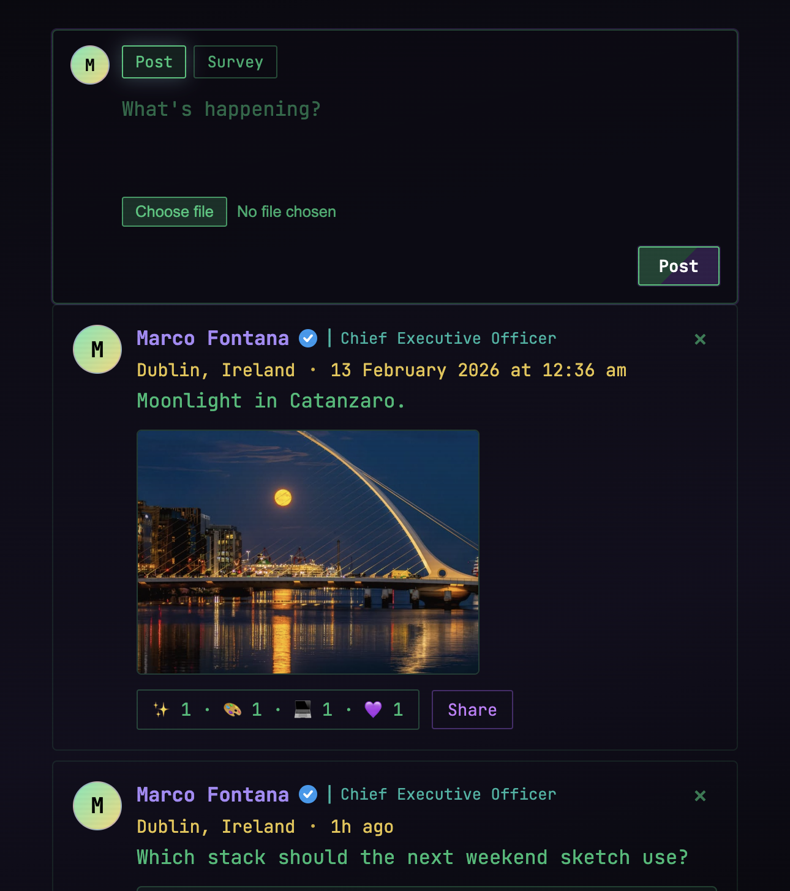
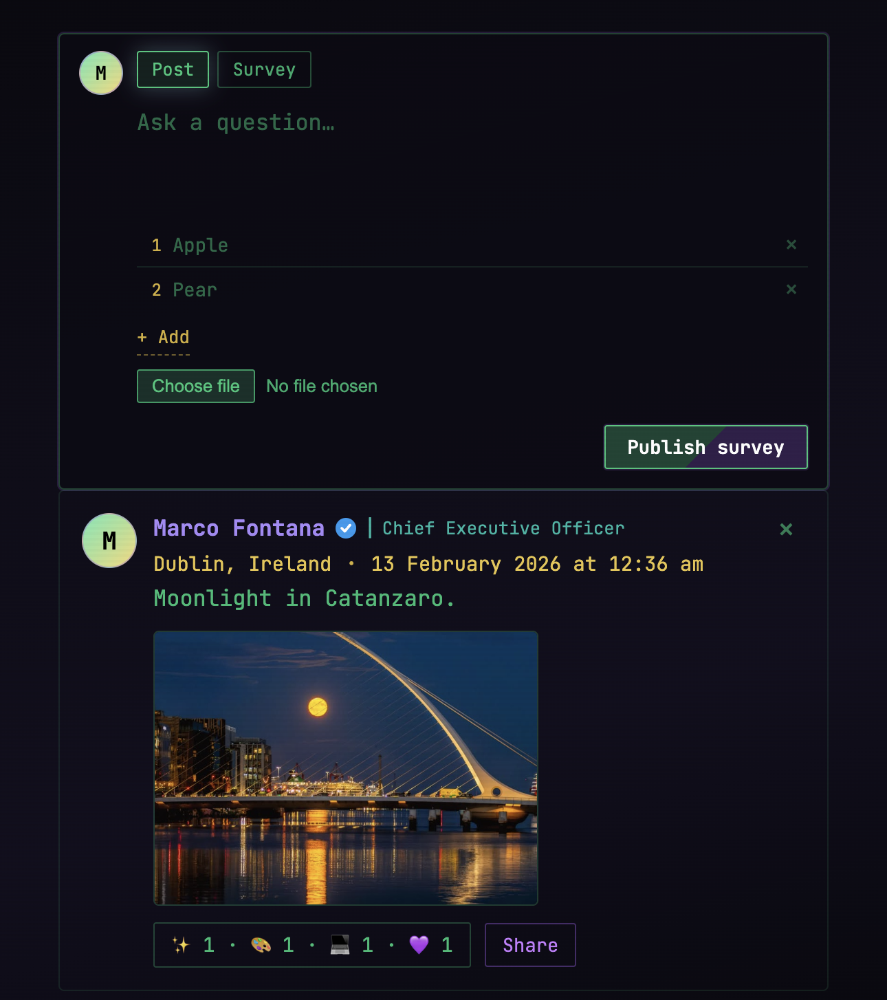

# dev-is.art

A small public feed for art and code. Visitors can read posts, react with emojis, vote on surveys, and share a post as an image. There are no comments. Publishing is limited to administrators identified by IP address.

The front end is a single page. The back end is PHP with a SQLite database and local image uploads.

<table>
  <tr>
    <td width="50%" align="center" valign="top">
      <a href="docs/feed.png">
        
      </a>
    </td>
    <td width="50%" align="center" valign="top">
      <a href="docs/compose.png">
        
      </a>
    </td>
  </tr>
</table>

<p align="center"><em>Click an image to zoom.</em></p>

## Features

- Text posts, optional images, and surveys
- Emoji reactions (one of each emoji per visitor)
- One survey vote per visitor
- Share-as-image export
- Admin compose box when the client IP is allow-listed
- Apache rules that keep `data.db` off the public web

## Requirements

- PHP 8.1+ with PDO SQLite and the `fileinfo` extension
- A writable `uploads/` directory
- Optional: Apache with `mod_rewrite` if you use the included `.htaccess`

## How to use

From the project root:

```bash
mkdir -p uploads
php -S 127.0.0.1:8080
```

Open [http://127.0.0.1:8080](http://127.0.0.1:8080).

### Publishing posts

Administrators are the IP addresses stored in `admin_ips`. On a fresh database the defaults are `127.0.0.1` and `::1`, so the compose box appears when you browse from the same machine.

To allow extra addresses before the first request:

```bash
export ADMIN_IPS="127.0.0.1,::1,203.0.113.10"
php -S 127.0.0.1:8080
```

From the compose box you can publish a post or a survey, attach a JPEG/PNG/GIF/WebP image, and delete your own posts.

### Typical visitor flow

1. Open the feed.
2. Choose **React** on a post and pick an emoji.
3. Vote on a survey if one is present.
4. Use **Share** to download a card image of the post.

## Project layout

```
index.html          # public page
assets/             # CSS and client JavaScript
api/bootstrap.php   # SQLite setup and admin check
api/posts.php       # list, create, delete posts
api/reactions.php   # reactions and survey votes
api/auth.php        # whether the current IP is admin
uploads/            # created at runtime
```

Runtime files (`data.db` and uploaded images) stay on the server and are not part of the source tree.

## License

GNU General Public License v3.0. See [LICENSE](LICENSE).
